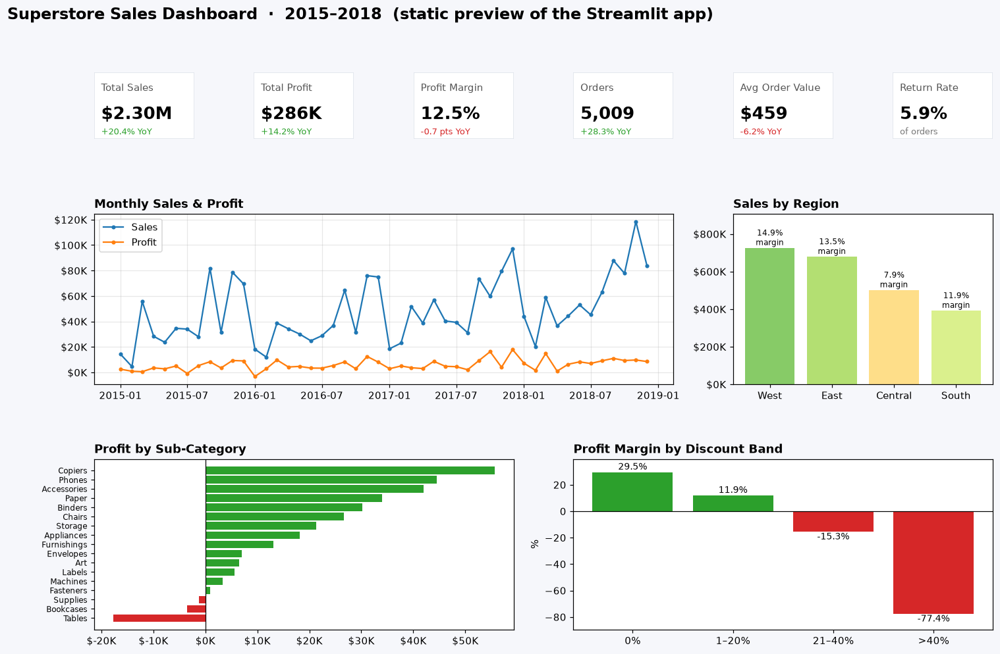

# Superstore Sales Dashboard — Streamlit + Excel KPI Report

Interactive sales dashboard built in **Streamlit + Plotly** on the Tableau *Sample – Superstore* dataset, plus an **Excel KPI workbook** and a Power BI-style KPI write-up. Filter by year, region, segment and category to track sales, profit, margin, AOV and returns, and find out where the business loses money.



*Static matplotlib preview of the dashboard, created by `src/make_preview.py`. The live app adds interactive filters, hover tooltips, a US state profit map and product tables.*

## Dataset
Tableau **Sample – Superstore** (fictional US office-supplies retailer), from the public mirror [`leonism/sample-superstore`](https://github.com/leonism/sample-superstore/blob/master/data/superstore.csv) → `data/superstore_raw.csv`.
- 9,994 order lines · 5,009 orders · 793 customers · orders dated 2015-01-03 → 2018-12-30
- That CSV stacks the *Orders* sheet with 806 rows from the *Returns* sheet; `src/kpis.py` separates them and flags the 302 returned orders.

## Dashboard features
- **KPI cards:** Total Sales, Profit, Profit Margin, Orders, AOV (with YoY change for the latest selected year) and Return Rate
- **Filters:** Year, Region, Segment, Category
- Monthly sales & profit trend · profit by sub-category · sales by region coloured by margin · US state profit map · margin by discount band · top-10 / bottom-10 products · YoY table · CSV download of filtered data

## Key results
| KPI | Value |
|---|---:|
| Sales (2015–2018) | **$2.30M** |
| Profit | **$286.4K** (12.5% margin) |
| 2018 sales growth | **+20.4%** YoY (profit +14.2%, margin −0.7 pts) |
| Orders / AOV | 5,009 / $459 |

**Insights**
- **Discounts above 20% destroy profit:** margin is 29.5% with no discount, −15.3% at 21–40% and −77.4% above 40%; those lines lose **$135K** in total.
- **Furniture is 32% of sales but 6% of profit** (2.5% margin); Tables (−$17.7K) and Bookcases (−$3.5K) lose money.
- **Central region has the weakest margin (7.9%)**; Texas, Ohio, Pennsylvania and Illinois are the biggest loss-making states.
- **Copiers, Phones and Accessories** are the most profitable sub-categories; paper products earn 42–44% margins.
- **Strong Q4 seasonality:** Sep/Nov/Dec run at 1.6–1.8× the average month.

Full write-up with tables and recommendations: **[KPI_REPORT.md](KPI_REPORT.md)** · Excel workbook: `outputs/superstore_kpi_report.xlsx`

## Repository structure
```
sales-dashboard/
├── app.py                       # Streamlit dashboard
├── data/superstore_raw.csv      # public sample dataset (auto-downloaded if missing)
├── src/
│   ├── kpis.py                  # data loading + KPI logic shared by everything
│   ├── make_preview.py          # static dashboard preview PNG
│   └── build_excel_report.py    # Excel KPI workbook (8 sheets)
├── images/dashboard_preview.png
├── outputs/superstore_kpi_report.xlsx
├── KPI_REPORT.md                # Power BI / Excel-style KPI write-up
├── requirements.txt
└── README.md
```

## How to run
```bash
pip install -r requirements.txt
streamlit run app.py                 # opens http://localhost:8501
python src/build_excel_report.py     # regenerate the Excel workbook
python src/make_preview.py           # regenerate the README preview
```
Deploy free on [Streamlit Community Cloud](https://streamlit.io/cloud) by pointing it at `app.py`.

## Tech stack
Python · pandas · Streamlit · Plotly · Matplotlib · openpyxl (Excel)

## Next steps
- Rebuild the same KPI pages in Power BI (DAX measures for YoY, margin and return rate).
- Add a sales forecast (Prophet) and customer RFM segments.
- Deploy to Streamlit Cloud and add a real browser screenshot.

## Author
**Pushpak Kumar Sahu** — [LinkedIn](https://linkedin.com/in/pushpak-kumar-sahu-2314593a6/) · p7050552704@gmail.com
